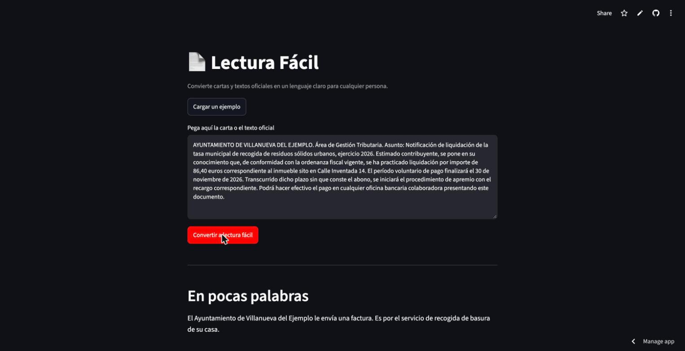
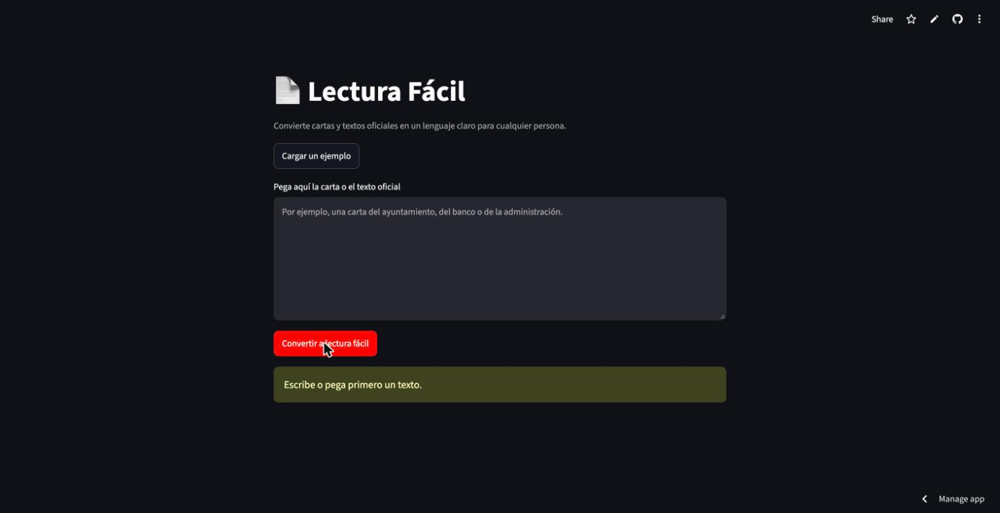
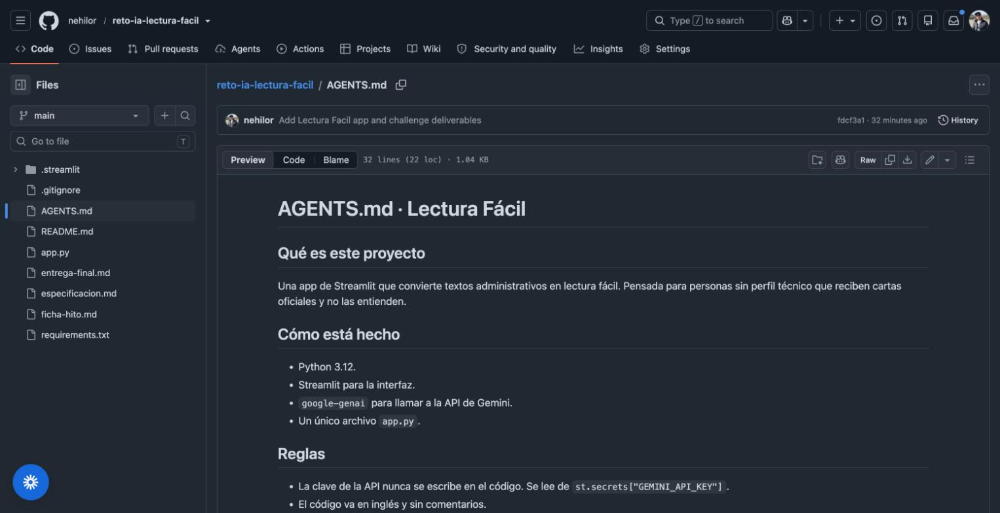
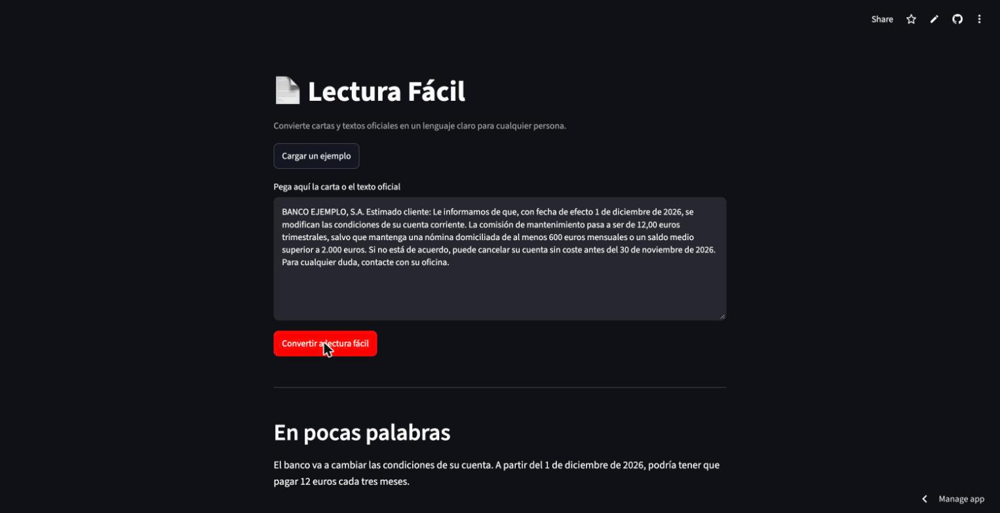

# Lectura Fácil

**Enlace a la app:** https://reto-ia-lectura-facil-lytixxzofy7zoxqckblkau.streamlit.app/
**Autor/a:** [tu nombre]

- **Qué usa:** API de Gemini (`gemini-2.5-flash`), Streamlit, `google-genai`.
- **Ruta de despliegue:** A · Streamlit Community Cloud.

## Pitch

Muchas personas mayores y personas que aprenden el idioma reciben cartas oficiales que no entienden y se arriesgan a perder plazos. Lectura Fácil reescribe esas cartas en lenguaje claro y dice en pocas líneas qué hay que hacer y para cuándo. La IA aporta lo que una plantilla fija no puede: entiende cualquier carta y la explica con palabras sencillas. En las pruebas, la sección "Qué tiene que hacer" fue la más útil, así que la dejé siempre visible. Lo siguiente sería aceptar fotos de la carta para no tener que teclearla.

## El problema

Las notificaciones de la administración, los bancos y los ayuntamientos están escritas en un lenguaje técnico y lleno de términos difíciles. Una persona mayor, o alguien que está aprendiendo el idioma, muchas veces no entiende qué le piden ni qué plazo tiene. Hoy lo resuelve pidiendo ayuda a un familiar o yendo a preguntar a una oficina, y a veces simplemente lo deja pasar. Merece la pena resolverlo porque entender un plazo a tiempo evita recargos y problemas.

## Qué hace la app

1. El usuario pega el texto de la carta o carga un ejemplo.
2. Pulsa un botón.
3. Recibe una versión fácil con cuatro bloques: en pocas palabras, explicación fácil, qué tiene que hacer y fechas y plazos.
4. Puede descargar el resultado.

## La pieza de IA

Usa la API de Gemini. La app prueba varios modelos en orden (`gemini-2.5-flash` y los modelos del curso `gemini-3.8-flash` y `gemini-3.5-flash-lite`) y usa el primero disponible, así que sigue funcionando si uno se retira o se agota su cuota. Las reglas de lectura fácil van en el system prompt. Si todos fallan, la app muestra un mensaje claro y no se rompe.

## Cómo la he construido

Partí de la plantilla de la Ruta A de la asignatura y la adapté de un chat a una herramienta de un solo paso. Trabajé con un asistente de IA: le pasé el `AGENTS.md`, le pedí la lógica de lectura fácil en el system prompt y revisé a mano el manejo de errores y los secretos.

## Prueba y mejora

| Quién probó | Qué probó | Qué pasó | Qué cambié | Cómo mejoró |
|---|---|---|---|---|
| Luis Andrés Colón (compañero de clase) | Abrió la app en el móvil y convirtió una carta | Funcionó y dio el visto bueno: "gran mejoría, excelente" | No pidió cambios | Confirmó que se entiende y funciona bien desde el teléfono |
| Prueba propia (autor) | Dos cartas reales (ayuntamiento y banco) y el caso del campo vacío | La conversión salió bien; con la cuota del modelo agotada la app se quedaba sin una respuesta clara | Añadí un modelo de reserva, un mensaje de error claro y un aviso cuando el campo está vacío | Si un modelo falla pasa al siguiente; con el campo vacío ya no llama al modelo y avisa |

Quien me dio feedback fue mi compañero Luis Andrés Colón, que probó la app desde el móvil y confirmó que funcionaba bien tras mis ajustes. En mi propia prueba, en el papel del usuario, convertí dos cartas distintas (una tasa municipal y un cambio de condiciones de un banco) y en los dos casos devolvió las cuatro secciones y extrajo bien la acción y la fecha. La mejora concreta salió de esas pruebas: añadí un modelo de reserva y un mensaje de error claro, para que si un modelo se cae o se agota la cuota la app pase al siguiente y avise en vez de romperse, y dejé el aviso para cuando el campo está vacío.

## Ejecutar en local (opcional)

```
# Pon la clave en .streamlit/secrets.toml y ejecuta
streamlit run app.py
```

## Capturas

La app funcionando: convierte una notificación del ayuntamiento en lectura fácil.



Caso límite: si el campo está vacío, la app avisa y no llama al modelo.



Trabajo con IA: el fichero de contexto AGENTS.md que leen los agentes.



Prueba: una carta distinta (un banco) convertida, en el papel del usuario.


