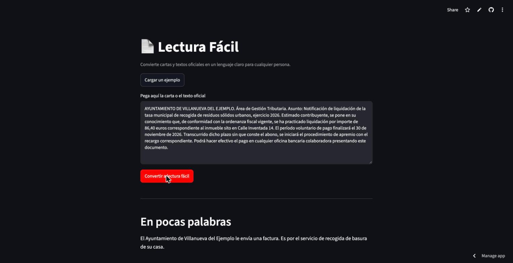
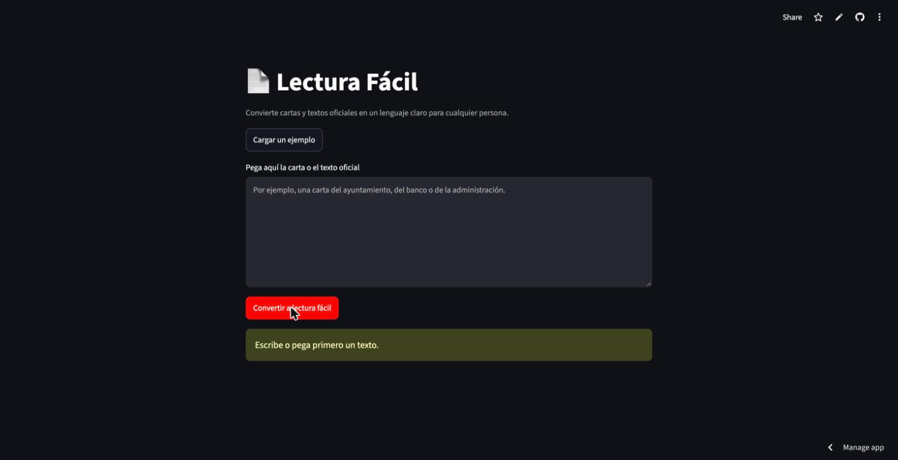
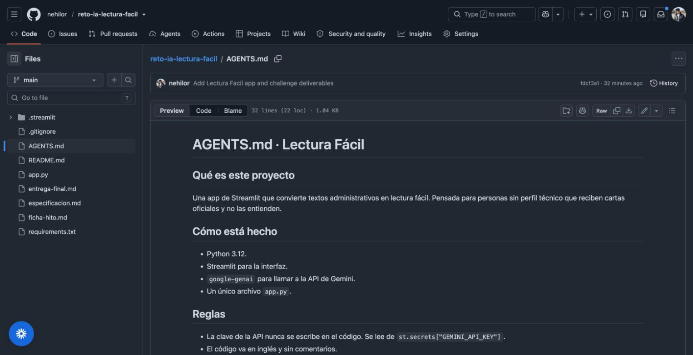
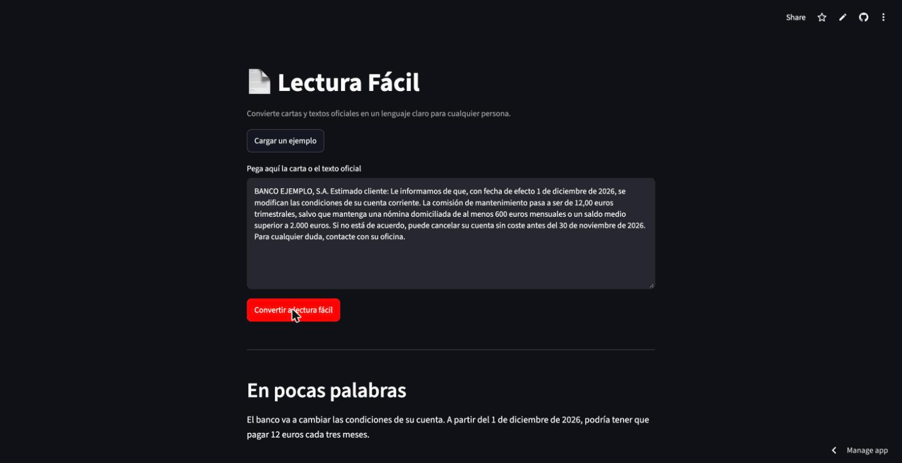

# Entrega final · Lectura Fácil

## 1. Enlaces

- App desplegada: https://reto-ia-lectura-facil-lytixxzofy7zoxqckblkau.streamlit.app/
- Repositorio: https://github.com/nehilor/reto-ia-lectura-facil

## 2. Problema y usuario

Las cartas oficiales del ayuntamiento, el banco o la administración están escritas en lenguaje burocrático. Una persona mayor o alguien que aprende el idioma muchas veces no entiende qué le piden ni qué plazo tiene. Hoy lo resuelve pidiendo ayuda a un familiar o yendo a una oficina. La IA reescribe la carta en lenguaje claro y extrae la acción y la fecha; queda fuera hacer el trámite o dar asesoría legal.

## 3. Especificación

Ver `especificacion.md` en el repositorio. Incluye problema y usuario, qué hace el producto, entradas y salidas, la pieza de IA, flujo, restricciones, criterios de aceptación, fuera de alcance y despliegue.

## 4. La pieza de IA

API de Gemini. La app prueba en orden `gemini-2.5-flash`, `gemini-3.8-flash` y `gemini-3.5-flash-lite`, y usa el primero disponible. Elegida porque reescribir en lenguaje claro es una tarea de lenguaje natural sin reglas fijas. Si se agota la cuota o hay un error, la app muestra un mensaje claro y pide reintentar.

## 5. Proceso con IA

- Fichero de contexto: `AGENTS.md`.
- Prompt clave: el `SYSTEM_PROMPT` de `app.py`, que fija las reglas de lectura fácil y las cuatro secciones de salida.
- Delegado al agente: la estructura inicial y la interfaz. Revisado a mano: el manejo de errores, el modelo de reserva y que la clave vaya solo en los secretos.

## 6. Prueba y mejora

| Quién probó | Qué probó | Qué pasó | Qué cambié | Cómo mejoró |
|---|---|---|---|---|
| Luis Andrés Colón (compañero de clase) | Abrió la app en el móvil y convirtió una carta | Funcionó y dio el visto bueno: "gran mejoría, excelente" | No pidió cambios | Confirmó que se entiende y funciona bien desde el teléfono |
| Prueba propia (autor) | Dos cartas reales (ayuntamiento y banco) y el caso del campo vacío | La conversión salió bien; con la cuota del modelo agotada la app se quedaba sin una respuesta clara | Añadí un modelo de reserva, un mensaje de error claro y un aviso cuando el campo está vacío | Si un modelo falla pasa al siguiente; con el campo vacío ya no llama al modelo y avisa |

Quien me dio feedback fue mi compañero Luis Andrés Colón, que probó la app desde el móvil y confirmó que funcionaba bien tras mis ajustes. En mi propia prueba, en el papel del usuario, convertí dos cartas distintas (una tasa municipal y un cambio de condiciones de un banco) y en los dos casos devolvió las cuatro secciones y extrajo bien la acción y la fecha. La mejora concreta salió de esas pruebas: añadí un modelo de reserva y un mensaje de error claro, para que si un modelo se cae o se agota la cuota la app pase al siguiente y avise en vez de romperse, y dejé el aviso para cuando el campo está vacío.

## 7. Pitch escrito

Muchas personas mayores y personas que aprenden el idioma reciben cartas oficiales que no entienden y se arriesgan a perder plazos. Lectura Fácil reescribe esas cartas en lenguaje claro y dice qué hay que hacer y para cuándo. La IA aporta lo que una plantilla fija no puede: entiende cualquier carta y la explica con palabras sencillas. En las pruebas, la sección "Qué tiene que hacer" fue la más útil, así que la dejé siempre visible. Lo siguiente sería aceptar fotos de la carta para no tener que teclearla.

## 8. Capturas

Captura 1: la app funcionando. Convierte una notificación del ayuntamiento en lectura fácil.

Captura 2: caso límite. Con el campo vacío, la app avisa y no llama al modelo.

Captura 3: trabajo con IA. El fichero de contexto AGENTS.md que leen los agentes.

Captura 4: prueba propia. Una carta distinta (un banco) convertida, en el papel del usuario.

